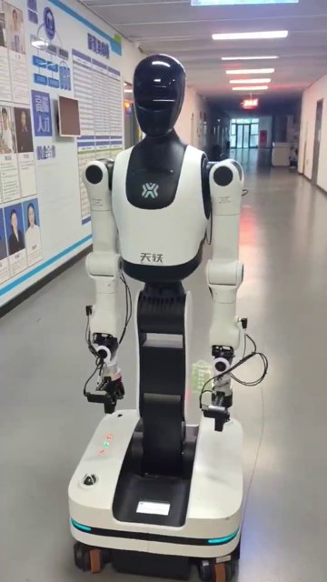
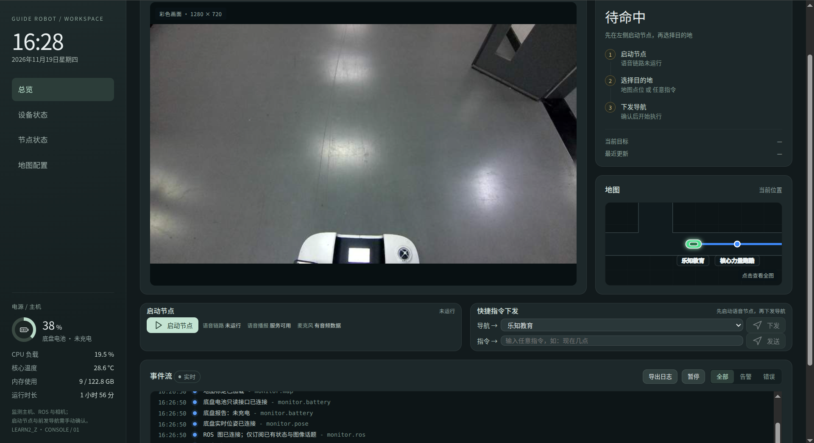
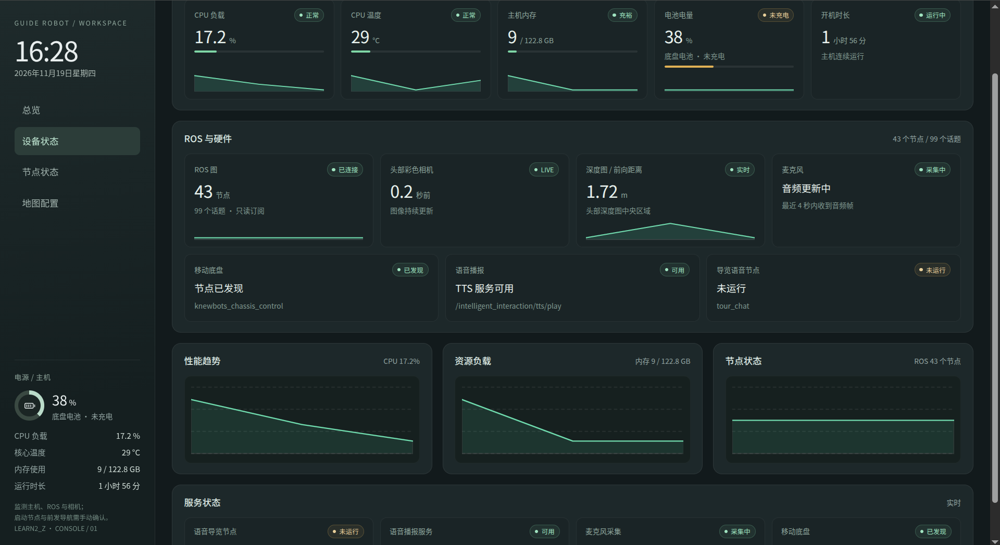
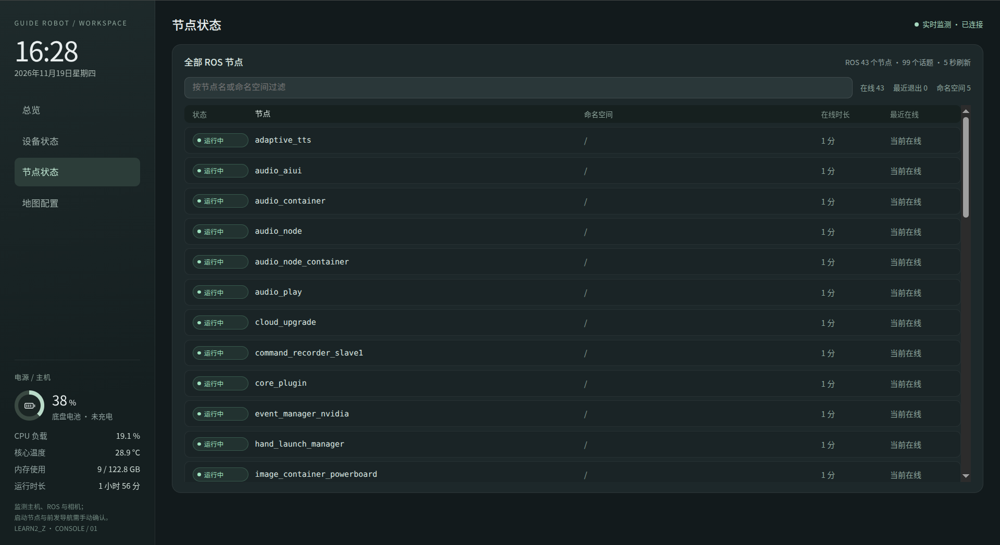
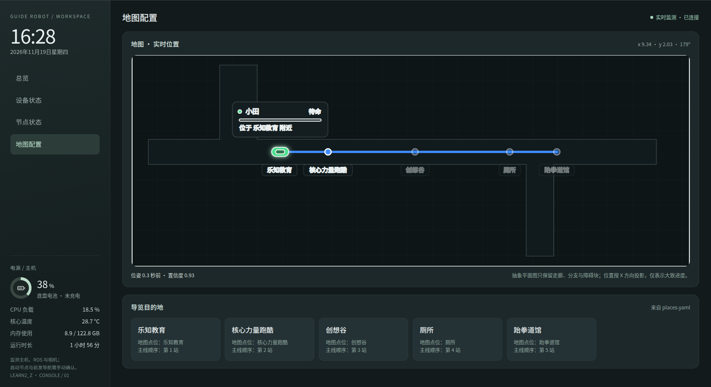

# 导览机器人语音交互

基于 ROS 2 Jazzy 的展厅导览机器人语音交互工作空间。机器人听懂访客说话，带访客前往展厅点位，到达后询问是否还有事，访客说“没有了”就回到配置的待命点待命。

```
访客说话 → 平台采集音频 → 本地 faster-whisper 转文字（默认）
        → 本地规则拆解 + 远程大模型兜底理解
        → 下发导航任务给底盘 → 到点后语音播报并询问 → 访客说没有则回待命点
```

核心原则：

- 硬决策在本地，软决策给模型：导航判断用代码规则，模型只处理模糊表达
- 模型输出必须校验：地点名必须真实存在于当前地图
- 模型永远不直接指挥底盘
- 输入进入独立工作线程串行处理，避免对话与导航等待阻塞 ROS 回调

## 运行环境

| 项     | 值                                                     |
| ------ | ------------------------------------------------------ |
| 设备   | Jetson AGX Thor Developer Kit                          |
| 系统   | JetPack 7 / aarch64                                    |
| ROS    | ROS 2 Jazzy（rclpy）                                   |
| 音频采集 | 平台麦克风阵列原始音频流 |
| 语音识别 | 默认本地 faster-whisper（CPU / small / int8），可切换平台 AIUI |
| 语音播报 | 平台 TTS |
| 大模型 | 远程 vLLM（OpenAI 兼容接口）                           |
| 底盘   | `robot_controller` SDK，REST 默认 `192.168.11.10:9090` |

## 目录结构

```text
learn2_Z/
├── README.md
├── .gitignore
├── docs/
│   ├── PROJECT_GUIDE.md      # 实现说明（部分历史描述需结合当前源码阅读）
│   ├── images/              # 工作台截图与视频封面
│   └── videos/              # 实机演示视频
├── web/
│   ├── README.md            # 工作台使用说明
│   ├── index.html / live.js # 页面与交互
│   ├── monitor.py          # 监测后端与确认控制接口
│   ├── start_monitor.sh    # 机器人环境启动脚本
│   └── test_monitor.py     # 后端测试
└── src/nav_pkg/
    ├── config/places.yaml  # 地点别名、待命点、主线配置
    ├── nav_pkg/
    │   ├── tour_chat.py    # 主节点：语音 → 理解 → 导航 → 播报
    │   ├── mic_asr.py      # 平台音频采集接口 + 本地 faster-whisper 识别
    │   ├── qwen.py         # 远程大模型 HTTP 客户端
    │   ├── places.py       # 中文别名 → 地图点位
    │   ├── nav_route.py    # 底盘导航封装 + 独立导航入口
    │   └── chat_say.py     # TTS 单句测试工具
    ├── setup.py            # tour_chat / nav_route / chat_say 三个入口
    └── package.xml
```

## 快速开始

以下命令在已配置 ROS 2 和机器人平台的设备上执行；工作空间路径按实际位置替换。

### 依赖准备

| 依赖 | 说明 |
| --- | --- |
| ROS 2 Jazzy、colcon、ament_index_python | ROS 运行、构建和包资源定位 |
| 平台 xos 环境 | 提供 `lyre_msgs`、`interaction_msgs`，以及音频采集、TTS 等运行服务；source 脚本仅加载环境，不会自动启动服务 |
| NumPy、PyYAML | 音频处理和地点配置 |
| faster-whisper 及其运行依赖 | 默认本地识别需要，在运行 `ros2 run` 所用的 Python 环境中安装；目标 aarch64 环境需有兼容的 CTranslate2 |
| `robot_controller` SDK | 本仓库未包含；默认从 `/home/nvidia/robot_controller/src` 导入，可用 `ROBOT_CONTROLLER_SRC` 指向实际 SDK 的 `src` 目录 |

`colcon build` 不会自动安装 faster-whisper 或外部底盘 SDK。即使设置 `enable_nav:=false`，当前模块仍会导入 SDK；平台消息类型和 NumPy 也仍需可导入。

首次使用 `small` 模型时需可下载模型或提前缓存；`asr_model` 也可指定已准备好的本地模型目录。代码在未设置 `HF_ENDPOINT` 时默认使用 `https://hf-mirror.com`。

### 构建与启动

```bash
cd ~/guide_robot/learn/learn2_Z
source /opt/ros/jazzy/setup.bash
source ~/xos/setup.bash          # 加载平台消息与服务类型环境
colcon build --packages-select nav_pkg
source install/setup.bash
```

启动主节点（默认本地识别、平台 TTS、导航开启）：

```bash
ros2 run nav_pkg tour_chat
```

只测对话、不动底盘：

```bash
ros2 run nav_pkg tour_chat --ros-args -p enable_nav:=false
```

没有麦克风时，可在第一个终端启动文本测试节点（关闭本地麦克风、平台心跳和唤醒词登记，导航仍开启）：

```bash
ros2 run nav_pkg tour_chat --ros-args \
  -p enable_mic:=false -p enable_asr:=false -p 'wake_word:=""'
```

在另一个已加载 ROS、xos 和本工作空间环境的终端发送文本：

```bash
ros2 topic pub --once /tour/chat std_msgs/msg/String "{data: '带我去创想谷'}"
ros2 topic pub --once /tour/chat std_msgs/msg/String "{data: '没有了'}"
```

单独测试：

```bash
# 独立导航：启动后会执行默认路线，请先确认运行场地
ros2 run nav_pkg nav_route

# 只测 TTS
ros2 run nav_pkg chat_say --ros-args -p text:="你好"
```

常用参数覆盖：

```bash
ros2 run nav_pkg tour_chat --ros-args \
  -p map:=消防 \
  -p track:=track_line_1003 \
  -p qwen_base_url:=http://127.0.0.1:8000/v1
```

> `tour_chat` 的 `track` 默认为空，走**点对点**，途中经过其它点位不会停；只有显式设置 `track_line_1003` 才沿轨道行驶。点对点任务统一用**本次行进朝向**（当前位姿指向目标）作为目标朝向（无法获取目标坐标时回退到 SDK 的点位导航）；目标在身后（夹角达到 90°）时先原地掉头，转向失败或转不到位就直接停车，不会带着错误朝向继续前进。

独立的 `nav_route` 默认沿 `track_line_1003` 执行路线，与 `tour_chat` 的点对点默认值不同。

Web 工作台的启动方式见 [web/README.md](web/README.md)。

## 语音识别（ASR）

默认使用**本地 faster-whisper（CPU / small / int8）**识别语音，不需要唤醒。这里的“本地”只指语音转文字：麦克风音频仍由平台提供，播报仍调用平台 TTS，聊天与模糊意图理解默认调用远程大模型。实际拾音方向和效果取决于麦克风及环境。

代码默认参数是 `enable_mic=True`、`enable_asr=False`；两个开关独立，关闭本地识别不会自动开启平台 AIUI。

| 项       | 本地模式（默认）                            | 平台模式                                                     |
| -------- | ------------------------------------------- | ------------------------------------------------------------ |
| 开关     | `enable_mic:=true` + `enable_asr:=false` | `enable_mic:=false` + `enable_asr:=true`     |
| 识别来源 | 订阅 `/lyre/audio_stream`，96k 重采样到 16k | 订阅 `/audio_asr/iat`                                        |
| 唤醒     | 不需要，能量 VAD 自动断句                   | 节点登记唤醒词「小田」；人脸等唤醒方式由平台配置决定                                     |
| 使能     | 无需心跳                                    | 每 0.5 秒向 `/intelligent_interaction/lyre/enable` 发 `true` |

本地模式用能量 VAD 断句（最短语音约 0.4 秒、静音约 0.8 秒收句、最长分段约 12 秒），播报期间自动静音麦克风，避免机器人听见自己。

如果要确认机器人上**当前运行的节点**用了哪种模式，应在机器人环境查询，而不是只看 README：

```bash
ros2 param get /tour_chat enable_mic
ros2 param get /tour_chat enable_asr
```

默认值描述的是本仓库当前源码；已部署的旧安装包或带参数启动的节点可能不同。修改源码后需重新构建并重启节点。

切换平台 AIUI（先停止已有的 `tour_chat`，切回本地模式时同样处理）：

```bash
ros2 run nav_pkg tour_chat --ros-args \
  -p enable_mic:=false \
  -p enable_asr:=true
```

切回本地识别：

```bash
ros2 run nav_pkg tour_chat --ros-args \
  -p enable_mic:=true \
  -p enable_asr:=false
```

本地模型加载失败时不会自动回退到平台 AIUI，需要修复模型依赖或按上面的命令切换。

当前代码始终订阅平台识别结果；`enable_asr` 只控制本节点是否发布平台使能心跳，不会屏蔽其他进程已开启的平台识别输入。

> 唤醒词通过 `/audio_aiui/wake_word_control` 在运行时登记，**不修改** `/opt/PARTITIONS/.../aiui_params.yaml`；`enable_mic=false` 时尝试登记（与 `enable_asr` 独立），`wake_word` 留空可跳过；正常退出时尝试恢复原状态。

## 交互流程

| 场景      | 触发                     | 行为                                                |
| --------- | ------------------------ | --------------------------------------------------- |
| 明确指令  | “带我去创想谷”           | 直接导航                                            |
| 模糊表达  | “创想谷”                 | 反问是否需要带路                                    |
| 确认/否认 | “好的” / “不用”            | 出发 / 放弃                                         |
| 间接意图  | “我想练跆拳道”           | 大模型推断地点后反问                                |
| 到达      | 导航完成                 | 播报并询问“现在还有什么事吗”                        |
| 无事      | “没有了 / 没有 / 没事了” | 说“好的，我这就回去”，返回待命点，到点再播报“到了…” |
| 超时      | 到点后 30 秒无人交互     | 自动说“没什么事了吧，我先回去了”并返回待命点        |
| 其它      | 任意闲聊                 | 大模型自由对话                                      |

导航期间会忽略新的语音和文本输入，避免中途改目标；播报结束后保留短暂静默，防止喇叭尾音被识别成指令。

## 主要参数

| 参数                             | 默认                                | 说明                                          |
| -------------------------------- | ----------------------------------- | --------------------------------------------- |
| `asr_topic` | `/audio_asr/iat` | 平台识别结果 |
| `enable_asr`                     | `False`                             | 平台 ASR 使能心跳（本地模式关闭）             |
| `enable_mic`                     | `True`                              | 本地麦克风识别开关                            |
| `mic_topic` | `/lyre/audio_stream` | 平台原始音频 |
| `mic_control_service` | `/lyre/audio_control` | 打开、关闭平台音频流 |
| `mic_rate_in` | `96000` | 输入采样率，按当前设备实测配置 |
| `vad_threshold` / `vad_silence_s` | `600.0` / `0.8` | 能量阈值 / 静音收句时间（秒） |
| `asr_model` / `asr_compute_type` | `small` / `int8`                    | faster-whisper 模型                           |
| `chat_topic`                     | `/tour/chat`                        | 文本直连                                      |
| `tts_service`                    | `/intelligent_interaction/tts/play` | 播报服务                                      |
| `enable_voice`                   | `True`                              | 是否启用 TTS                                  |
| `enable_greet`                   | `True`                              | 启动问候                                      |
| `min_chars`                      | `2`                                 | 最短有效字数（单字“好”“行”默认会被过滤，建议说“好的”“可以”）                                  |
| `dedupe_window`                  | `2.0`                               | 去重窗口（秒）                                |
| `idle_return_s`                  | `30.0`                              | 到点后多久无人交互自动回待命点，`0` 关闭      |
| `qwen_base_url`                  | `http://120.48.75.178:7006/v1`      | 模型地址                                      |
| `qwen_api_key` | `EMPTY` | 模型接口 Bearer 凭据占位符，按服务要求覆盖 |
| `qwen_model`                     | `Qwen3.5-122B-A10B`                 | 模型名                                        |
| `qwen_timeout`                   | `30.0`                              | 请求超时                                      |
| `history_turns`                  | `6`                                 | 闲聊历史轮数                                  |
| `enable_nav`                     | `True`                              | 是否启用导航                                  |
| `host` / `rest_port`             | `192.168.11.10` / `9090`            | 底盘 REST                                     |
| `map`                            | `消防`                              | 地图名                                        |
| `wake_word`                      | `小田`                              | 运行时登记的语音唤醒词，留空则不登记          |
| `reloc_poi`                      | `乐知教育`                          | 重定位参考点                                  |
| `track`                          | `""`（点对点）                      | 虚拟轨道；设为 `track_line_1003` 恢复轨道导航 |
| `nav_timeout`                    | `180.0`                             | 单次导航超时                                  |
| `detour_enabled`                 | `True`                              | 障碍长时间不动时是否尝试小步绕行              |
| `detour_after_s`                 | `1.0`                               | 两遍提示后仍被挡，再等多少秒就绕行            |
| `obstacle_text`                  | `正在执行任务，请让一让`            | 检测到障碍时的播报内容，间隔 1 秒，共两遍     |
| `detour_side_m`                  | `0.4`                               | 侧移距离（米，上限 0.5）                      |
| `detour_fwd_m`                   | `0.6`                               | 绕行后前进距离（米，上限 1.0）                |
| `detour_clear_m`                 | `1.0`                               | 侧方最小净空，不足则不动                      |
| `detour_max_tries`               | `2`                                 | 单次导航最多绕行次数                          |
| `detour_side_sign`               | `1.0`                               | 侧移方向符号，方向反了改 `-1.0`               |
| `depth_topic`                    | `/ob_camera_head/depth/image_raw`   | 判断左右净空的深度图                          |
| `places_file`                    | `""`                                | 空则使用安装包内 `config/places.yaml`             |
| `log_file`                       | `""`                                | 空则写入 `~/guide_logs/`                      |

## 对外接口

订阅：

| 话题                 | 类型                   | 用途         |
| -------------------- | ---------------------- | ------------ |
| `/lyre/audio_stream` | `lyre_msgs/AudioFrame` | 本地识别启用时接收平台音频 |
| `/ob_camera_head/depth/image_raw` | `sensor_msgs/Image` | 绕行启用时判断净空 |
| `/audio_asr/iat`     | `lyre_msgs/AsrIat`     | 语音识别文字 |
| `/audio_asr/keyword` | `lyre_msgs/AsrKeyword` | 唤醒事件     |
| `/tour/chat`         | `std_msgs/String`      | 文本输入     |

发布：

| 话题                                   | 类型            | 用途         |
| -------------------------------------- | --------------- | ------------ |
| `/intelligent_interaction/lyre/enable` | `std_msgs/Bool` | 仅 `enable_asr=true` 时发布平台 ASR 使能心跳 |

服务：

| 服务                                | 类型                          | 用途           |
| ----------------------------------- | ----------------------------- | -------------- |
| `/intelligent_interaction/tts/play` | `interaction_msgs/TtsService` | append / query |
| `/lyre/audio_control` | `lyre_msgs/AudioControl` | 本地识别启用时开关原始音频流 |
| `/audio_aiui/wake_word_control` | `lyre_msgs/WakeWordControl` | 关闭本地识别且唤醒词非空时尝试登记、恢复 |

外部调用：

| 目标     | 端点                                             |
| -------- | ------------------------------------------------ |
| 大模型   | `POST {qwen_base_url}/chat/completions`          |
| 底盘导航与状态 | 通过外部 `robot_controller` SDK 调用 REST；具体 HTTP 路径以 SDK 实现为准 |

## 地点配置

源码中的 `src/nav_pkg/config/places.yaml` 维护点位别名与路线；默认运行时读取安装包中的副本，修改源码配置后需重新构建，或用 `places_file` 指定配置的绝对路径：

```yaml
standby: 乐知教育

aliases:
  乐知教育: 乐知教育
  乐知院: 乐知教育
  核心跑酷: 核心力量跑酷
  3号点: 创想谷
  卫生间: 厕所
```

- `standby`：访客说完事后返回的待命点
- `aliases`：中文别名 → 地图点位，支持一个点位多个别名
- `transfer_points`：只作中转，不出现在可去地点清单
- `main_line` / `branches`：主线与支线顺序（当前仅解析，尚未用于逐点巡线）

## 日志

有效输入、部分被忽略的输入、播报和导航事件会尝试写入日志；默认路径：

```
~/guide_logs/tour_chat_YYYYMMDD.log
```

## 已知限制

| #   | 限制                                | 影响                 |
| --- | ----------------------------------- | -------------------- |
| 1   | 模型请求无重试、无备用端点          | 闲聊失败时提示；到达播报使用固定话术兜底       |
| 2   | 默认模型地址为明文 HTTP，凭据默认 `EMPTY` | 服务端是否要求鉴权需按实际部署确认       |
| 3   | 模型超时 30 秒偏长                  | 排队阻塞体验差       |
| 4   | 对话历史不重置                      | 跨访客上下文可能串味 |
| 5   | `main_line` / `branches` 未接入导航 | 无法逐点巡线讲解     |
| 6   | 平台唤醒与拾音效果依赖实际配置      | 本节点不保证各个方向均可识别       |
| 7   | 导航期间忽略新指令                  | 需到点后再下新目标   |

## 实机演示视频

机器人在走廊中的实机演示，时长约 71 秒。点击封面打开 MP4 视频（约 14 MB）。

[](docs/videos/robot-demo.mp4)

[打开或下载演示视频](docs/videos/robot-demo.mp4)

## 工作台截图

实机监控页面截图；截图时语音导览节点尚未启动。

### 总览



### 设备状态



### 节点状态



### 地图配置



## 相关文档

- [PROJECT_GUIDE.md](docs/PROJECT_GUIDE.md)：实现说明与设计决策（含历史描述；当前默认值以源码和本文为准）
- [Web 工作台说明](web/README.md)：监控、启动节点与下发指令

## 常见问题

| 现象           | 排查                                                                                                                            |
| -------------- | ------------------------------------------------------------------------------------------------------------------------------- |
| 说话完全没反应 | 本地模式：检查 `/lyre/audio_control`、`/lyre/audio_stream` 与模型加载日志；平台模式：确认 `enable_mic=false`、`enable_asr=true`、心跳和平台唤醒状态                                                         |
| 有识别但不回应 | 可能处于导航/播报中，被“忙”过滤                                                                                                 |
| 大模型无回应   | 检查模型服务可达性，查看日志错误                                                                                                |
| 不动           | 底盘健康检查未通过或定位未就绪                                                                                                  |
| 走一半停下     | 先间隔 1 秒播报两遍“正在执行任务，请让一让”，仍被挡且绕行开启时尝试小步绕行（侧移 0.4m + 前进 0.6m，最多 2 次）；深度不可用或净空不足则放弃绕行并报告导航失败 |
| 到点报失败     | 部分底盘失败或超时会按距目标 1 米以内兜底；先检查定位、目标坐标和障碍日志，容差是代码常量而非 ROS 参数                                                                                                   |
